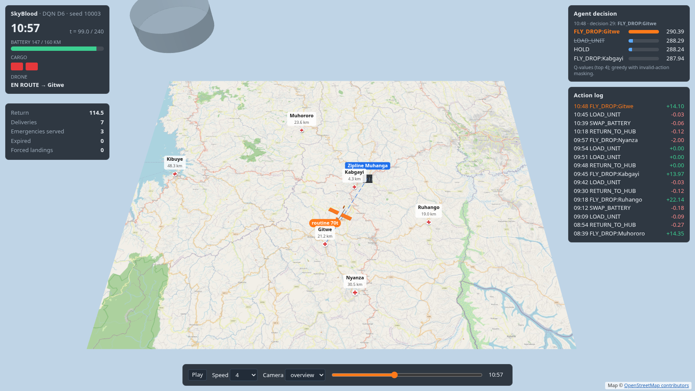

# SkyBlood: reinforcement learning for drone blood delivery in Rwanda

A mission-based custom Gymnasium environment in which an RL agent acts as the **hub dispatcher** of a Zipline-style blood-delivery drone at **Muhanga, Rwanda**. Four algorithms, **DQN, REINFORCE, PPO and A2C (TorchRL)**, are trained on the same environment with an equal budget of 1M decisions per run, 10 hyperparameter configurations each. The best agents are shown in a three.js viewer on an OpenStreetMap basemap.



## Mission and why RL

Postpartum haemorrhage is a leading cause of maternal death. Since 2016, Zipline has flown blood to Rwandan hospitals from Muhanga: 28,754 units in 2023, with an average delivery time of about 25 minutes. About 30% of these deliveries are emergencies. The drones fly pre-cleared routes on autopilot; the hard decisions belong to the dispatcher: what to load, when to launch, where to fly first, when to swap the battery, whether to fly through bad weather, and when to come home.

The dispatcher's job is an RL problem rather than a prediction or routing problem:
- Orders and weather are random.
- Battery, cargo and position carry over from one decision to the next.
- Many choices pay off only later; a skipped battery swap causes a forced landing two flights later.
- No closed-form optimal policy exists.

The environment is a **semi-MDP**: each decision lasts a variable number of 3-minute ticks.

## Environment summary (`environment/custom_env.py`)

| | |
|---|---|
| World | One drone, the Muhanga hub and 6 hospitals at their real OSM positions, 4–48 km away. 12-hour shift = 240 ticks of 3 min. Cruise speed 5 km/tick, 160 km battery, 2 blood units per sortie. A 12 km storm cell drifts randomly. |
| Actions, `Discrete(10)` | `HOLD`, `LOAD_UNIT`, `SWAP_BATTERY`, `FLY_DROP:k` for each of the 6 hospitals, `RETURN_TO_HUB`. Each maps to a real hub operation: packing a unit, a battery swap, a catapult launch plus a parachute drop, a recovery-wire catch. |
| Observation, `Box(-1, 1, (38,))` | Drone position, battery, cargo; per hospital: relative position, urgency and time left; whether each route crosses the storm; storm position; at-hub flag; shift clock. Every index's meaning, encoding, simulation rule, update cadence and real-world source is tabulated in `.docs/report_notes.md` §2.3. |
| Reward | Emergency delivery +20 and routine +10, each plus up to +5 for speed. Waiting cost −0.03 (routine) or −0.06 (emergency) per open order per tick. Expiry −5 (routine) or −10 (emergency). Wasted unit −2. Invalid action −0.5. Forced landing −20 (−2 per unit lost) plus 1 hour out of service. |
| Start state | Drone at the hub with a full battery and no cargo; 2 random open orders; storm 15–45 km away with a random drift. |
| Terminal | Terminated after the **3rd** forced landing (aircraft grounded). Truncated at the end of the shift (t = 240). |
| Stochasticity | Bernoulli orders (0.01 per tick per free hospital, 1/3 emergencies), random-walk storm. |

**Delayed trade-offs the agent must learn:**
- batch two units or launch one now;
- swap the battery or save 6 minutes;
- a near routine order or a far emergency;
- fly through the storm (×1.5 energy, ×1.3 time) or hold;
- after a drop, return home or fly on with the second unit.

Invalid actions are penalised (−0.5) during training. Evaluation and `play.py` always use **greedy with invalid-action masking**: infeasible actions, such as LOAD while airborne, are excluded before the argmax.

**Baselines** (`uv run main.py baselines`, held-out seeds 10000–10019): greedy heuristic **195.6 ± 50.4**, masked random −21.2, hold forever −72.5, random −103.3.

## Install

Requires [uv](https://docs.astral.sh/uv/). Python 3.13 is fetched by uv. PyTorch is pinned to the CPU build. Environment stepping dominates the cost, so a GPU barely helps.

```bash
uv sync
uv run pytest -q          # 28 tests: environment, specs, training smoke tests, viewer traces, analysis
```

## Commands

```bash
# training: one run per command, 1,000,000 frames (decisions) each
uv run main.py train --algo {dqn,reinforce,ppo,a2c} --config D1 [--seed 0] [--device cpu|cuda] [--frames N] [--masked]

uv run main.py eval --algo ppo --config P4          # final and best-eval checkpoints, held-out seeds 10000-10019
uv run main.py baselines                            # heuristic / hold / random / masked random
uv run main.py analyze                              # all figures and tables into assets/ (about 1 min)

uv run play.py --algo dqn --config best --demo      # best DQN in the 3D viewer plus a verbose terminal log
uv run play.py --algo heuristic --seed 10003        # rule-based comparison
uv run play.py --algo ppo --no-browser              # terminal only
uv run play.py --algo a2c --export a2c.json         # JSON trace for replay
uv run play.py --algo dqn --config best --p-order 0.02 --demo   # double demand, never seen in training
uv run play.py --algo heuristic --p-order 0.02 --seed 10013     # the heuristic on the same busy day
```

- `--frames` is for smoke tests only. `--device cuda` needs a CUDA build of PyTorch: remove the `[tool.uv.sources]` torch entry from `pyproject.toml` and run `uv sync`.
- `--config best` picks the config with the highest final evaluation in `logs/`.
- `--p-order` sets the demand: the chance per tick that a hospital with no open order places one. Training used 0.01; 0.02 doubles demand, a load the agents never saw. The viewer then shows "demand ×2.0" in its title.

Each run writes:
- `logs/<algo>/<config>/`: `config.json`, `episodes.csv`, `train.csv` (loss, Q and ε for DQN; entropy, losses and lr for the policy-gradient methods), and `eval.csv` (every 100k frames plus final);
- `models/dqn/<config>.pt` or `models/pg/<algo>_<config>.pt`, plus `_best.pt`: the highest evaluation *during* that run, selected on the evaluation seeds, so optimistic. Report the final checkpoint.

**Networks:** 64×64 Tanh MLPs for the policy-gradient actor and critic, and 128×128 for the DQN Q-network.

## Experiments

There are 10 configurations per algorithm. Each changes **one** factor from that algorithm's baseline, so effects can be attributed. All 40 runs used training seed 0 and the same 1M-frame budget. They were run in 3 batches on a 12-core Xeon server in about 45 minutes.

| Algorithm | Factors varied |
|---|---|
| DQN (D1–D10) | lr, γ, replay size, batch size, ε-annealing length (10/50/80%), soft vs hard target, double Q on/off |
| REINFORCE (R1–R10) | lr, γ, episodes per update (2/8/32), value baseline on/off, entropy bonus, advantage normalisation. True Monte Carlo: complete episodes, TD1 returns. |
| PPO (P1–P10) | lr, rollout length, epochs, clip ε (0.1/0.2/0.3), entropy, GAE λ |
| A2C (A1–A10) | lr, steps per env (5/16/64), GAE λ vs n-step, entropy, value coefficient, γ |

The full tables with results are in `assets/summary_<algo>.md`.

**Best configuration of each algorithm** (final checkpoint, greedy with masking, held-out seeds 10000–10019):

| Algorithm | Config | Final eval | Deliveries | Emergencies | Forced landings |
|---|---|---|---|---|---|
| DQN | D6 (small batch) | 212.3 ± 61.5 | 13.40 | 4.25 | 0.00 |
| PPO | P4 (short rollout) | 205.2 ± 61.6 | 13.35 | 4.55 | 0.00 |
| REINFORCE | R9 (entropy 0.05) | 198.6 ± 67.3 | 12.50 | 4.10 | 0.00 |
| A2C | A3 (fast lr) | 198.0 ± 61.8 | 13.25 | 4.20 | 0.10 |
| *Greedy heuristic* | | *195.6 ± 50.4* | *12.50* | *4.00* | *0.00* |

**Paired load test** (`assets/stress_test.md`): each agent and the heuristic play the same 200 unseen seeds.
- **Nominal demand:** the agents match the heuristic. DQN scores +3.0 (95% CI −1.6 to +7.6); the others score 3–4% lower.
- **Doubled demand,** never seen in training: all four beat it by **+60 to +67** points, with confidence intervals well clear of zero.

The learned policies batch two units per sortie, fly on to a second hospital and swap batteries less often (`assets/behaviour.md`). They also drop some units speculatively where no order is open, a limitation of the small −2 wasted-unit penalty.

All conclusions rest on one training seed per configuration.

## Viewer (`environment/rendering.py`, `environment/viewer/`)

**The scene:** three.js r170, vendored locally with no build step, over an OpenStreetMap basemap. It shows:
- the hub (pad, catapult, recovery wire);
- the 6 hospitals with order badges (orange routine, red pulsing emergency, with ticks left);
- the drone flying arcs, with its planned route drawn in red when it crosses the storm;
- parachute drops with floating reward text, and the forced-landing animation;
- the drifting storm cylinder.

**Panels and controls:**
- HUD (clock, battery, cargo, drone state) and stats.
- The agent's top-4 action probabilities or Q-values.
- A scrolling action log.
- Play/pause, speed, camera and a scrub bar.

**How it works:**
- `play.py` starts a small FastAPI server. The page connects to `ws://…/ws?algo=&config=&seed=&speed=&p_order=`, and the server streams one `init` message, one `step` message per decision (paced in simulated time) and an `end` message. Each `step` carries the action, the reward breakdown, flight data and the agent's top action scores; `ticks` carries the order book and storm per tick.
- The same messages can be saved as a JSON trace with `play.py --export NAME` and replayed without a model: open `/?ep=traces/NAME`. Add `&t=46.5` to jump to a moment, or `&cam=overview|follow` to set the camera.
- Checkpoints are plain `state_dict`s plus their config, so `play.py` rebuilds the same TorchRL modules to load them. TorchRL 0.15's `export_onnx_policy` could export a policy to ONNX if it were needed elsewhere.

### OpenStreetMap attribution and tile policy

Map data © [OpenStreetMap contributors](https://www.openstreetmap.org/copyright), shown on screen in the viewer. `tools/fetch_tiles.py` fetched the basemap **once**: 80 standard tiles at zoom 12, sequential, with an identifying User-Agent, cached locally and stitched into `environment/viewer/basemap.jpg`. The viewer never hot-links tiles. Rerunning the script uses the cache.

## Project layout

```
ml-tech-2-summative/
├── main.py                  # CLI: train / eval / baselines / analyze
├── play.py                  # run an agent in the viewer with a verbose terminal log
├── environment/
│   ├── custom_env.py        # SkyBloodEnv + baselines
│   ├── rendering.py         # traces, JSON export, FastAPI websocket server, model loading
│   └── viewer/              # index.html, main.js, style.css, basemap, vendor/three r170, traces/
├── training/
│   ├── __init__.py          # env construction, masked-greedy evaluation, logging and checkpoints
│   ├── dqn_training.py      # DQN configs D1–D10
│   ├── pg_training.py       # REINFORCE, PPO, A2C configs
│   └── analysis.py          # figures and tables for `main.py analyze`
├── models/dqn/, models/pg/  # checkpoints (final + _best)
├── logs/                    # per-run CSV logs
├── runs/                    # terminal output of the 40 training runs
├── assets/                  # figures and summary tables
├── tools/fetch_tiles.py     # one-off OSM tile fetch and stitch
├── tests/                   # pytest
└── .docs/                   # guidelines, decisions, errors, report notes
```
